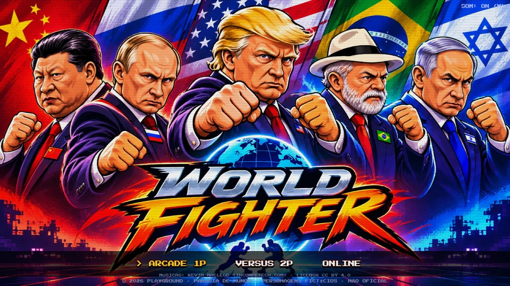
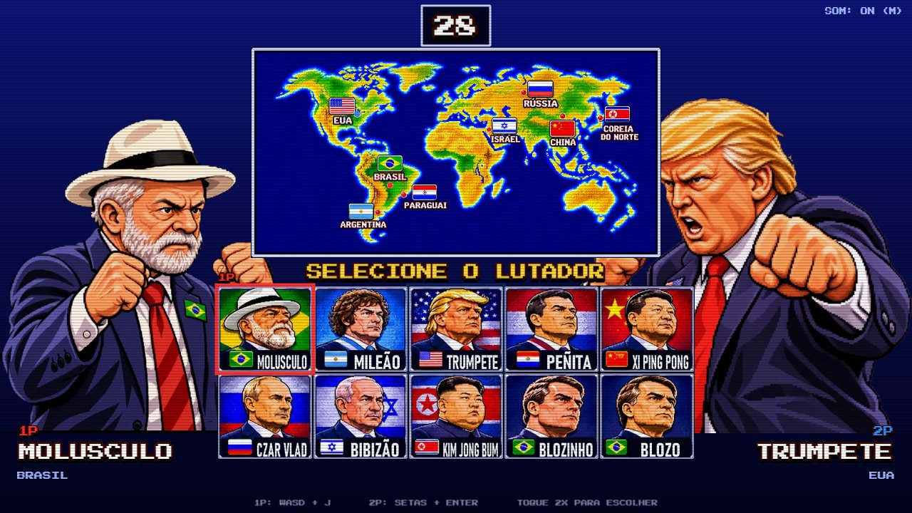
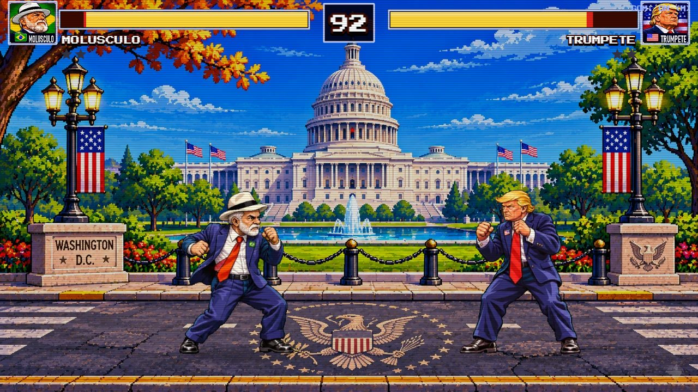
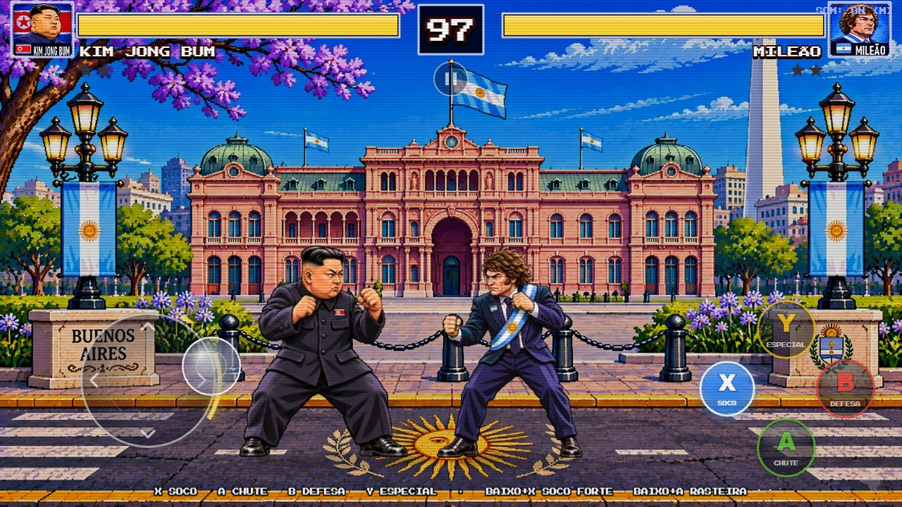
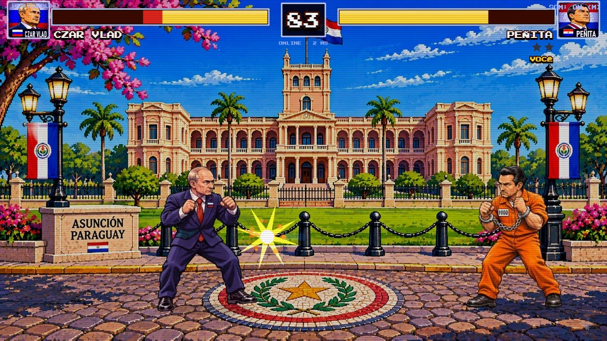
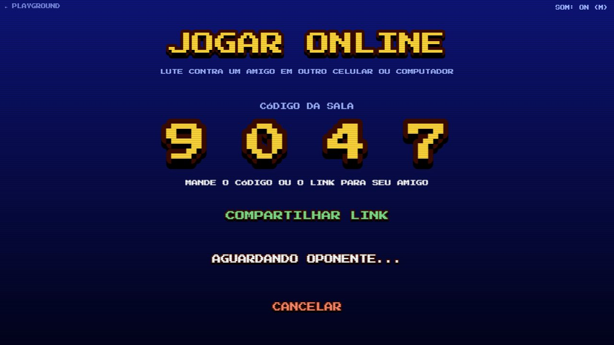
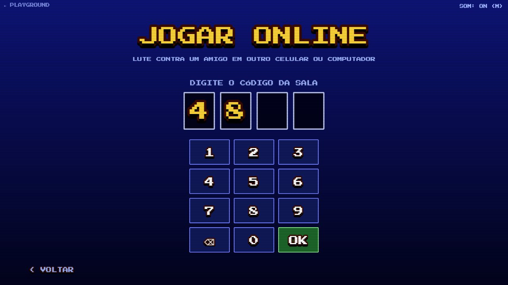

# World Fighter

Jogo de luta 2D para navegador no estilo dos fliperamas dos anos 90, com caricaturas de líderes políticos. Feito em JavaScript com [Phaser 4](https://phaser.io/), sem build e sem dependências para instalar.

**▶ Jogar agora:** <http://playground.gamer.free/worldfight/>



> **Paródia de humor.** Os personagens são caricaturas fictícias de figuras públicas. Nada no jogo é afirmação de fato sobre essas pessoas, e o projeto não tem vínculo com elas, com partidos ou com governos.

## Recursos

- **10 lutadores de 8 países**, cada um com cenário e música próprios (os brasileiros têm cenário por lutador).
- **Modos:**
  - **Arcade:** escada contra os outros nove e, no fim, o **chefe final XANDÃO**, que entra voando de toga, bate mais forte e aguenta mais. Quem vence o chefe zera o jogo e libera o XANDÃO na seleção (fica salvo no navegador).
  - **Versus:** dois jogadores no mesmo teclado ou com dois controles.
  - **Online:** contra um amigo em outro aparelho, por código de sala ou link de convite.
- **Golpes:** jab, soco forte, chute alto, rasteira (derruba), golpes no ar, defesa e especial com bola de energia nas cores do país.
- **Partidas:** melhor de 3 rounds de 99 segundos, com KO em câmera lenta, queda com quique, "PERFEITO" e revanche.
- **Comemorações de vitória** próprias de cada lutador: o "L" do Molusculo, a camiseta rasgada do Blozo, a dancinha do Trumpete, o polegar para baixo do XANDÃO ("Você foi subjugado") e outras, com fala.
- **Celular e tablet:**
  - direcional analógico 360° flutuante e botões A/B/X/Y no estilo do controle do Xbox;
  - tela cheia automática;
  - pausa por toque.
- **Controle (gamepad)** e teclado.
- **Som:**
  - locutor em inglês ("Round one… Fight!", "K.O.", "Perfect");
  - nomes dos lutadores anunciados;
  - falas de combate e gemidos de dor;
  - trilha de Kevin MacLeod (CC BY 4.0).
- **Motor de luta determinístico** (60 Hz, separado do Phaser). É ele que permite o online por troca de comandos e os testes no Node.

| Seleção | Luta |
| --- | --- |
|  |  |
| **Celular (controles de toque)** | **Online** |
|  |  |

## Rodar no seu computador

O jogo é um site estático, mas usa módulos JavaScript. Por isso precisa ser aberto por um servidor HTTP, e não direto do arquivo (`file://`). Qualquer servidor serve. Com Python:

```bash
cd site/worldfight
python -m http.server 8000
```

Depois abra <http://localhost:8000>.

O modo online precisa de internet nos dois aparelhos. Os demais modos funcionam sem conexão: a única coisa baixada de fora é a biblioteca do online, e só quando esse modo é aberto.

Para publicar, copie a pasta `site/worldfight/` para qualquer hospedagem de arquivos estáticos (GitHub Pages, Netlify, Apache, nginx etc.). Mais detalhes em [docs/PUBLICAR.md](docs/PUBLICAR.md).

## Controles

### Teclado

| Ação | Arcade / Online | Versus 1P | Versus 2P |
| --- | --- | --- | --- |
| Andar | A / D ou ← / → | A / D | ← / → |
| Pular | W ou ↑ | W | ↑ |
| Agachar | S ou ↓ | S | ↓ |
| Soco | J ou Z | J | 1 (numérico) ou , |
| Chute | K ou X | K | 2 (numérico) ou . |
| Defesa (segurar) | L ou C, ou andar para trás | L | 3 (numérico) ou / |
| Soco forte | baixo + soco | | |
| Rasteira (derruba) | baixo + chute | | |
| Especial | baixo, frente + soco | | |
| Pausa | P ou Esc | | |
| Som liga/desliga | M | | |

### Controle (gamepad)

Direcional ou analógico esquerdo para mover. A ou Y soco, X ou B chute, gatilhos ou bumpers para defesa. No Versus, o controle 1 é o 1P e o controle 2 é o 2P.

### Celular e tablet

| Botão | Golpe |
| --- | --- |
| **X** (azul) | Soco |
| **A** (verde) | Chute |
| **B** (vermelho) | Defesa (segurar) |
| **Y** (amarelo) | Especial |
| baixo + X | Soco forte |
| baixo + A | Rasteira |

O direcional aparece onde o polegar encosta na metade esquerda da tela. O botão ❚❚ abaixo do relógio pausa a luta.

## Modo online

| Criar a sala | Entrar na sala |
| --- | --- |
|  |  |

1. Um jogador escolhe **ONLINE → CRIAR SALA** e recebe um código de 4 dígitos. O botão **COMPARTILHAR LINK** manda um convite que já abre o jogo na sala.
2. O outro escolhe **ENTRAR NA SALA** e digita o código, ou só abre o link.
3. Cada um escolhe o seu lutador. Quem criou a sala é o 1P (esquerda).

A ligação é direta entre os dois navegadores (WebRTC, com a biblioteca [PeerJS](https://peerjs.com/)), sem servidor próprio. O servidor público do PeerJS só apresenta os dois jogadores.

A luta roda em *lockstep*: cada lado envia apenas os comandos de cada quadro, e os dois motores calculam a mesma luta. A cada 2 segundos os lados conferem se continuam iguais. Explicação completa em [docs/ONLINE.md](docs/ONLINE.md).

## Estrutura

```
site/worldfight/          o jogo (é esta pasta que vai para o servidor)
  index.html
  CREDITOS.txt
  js/
    main.js               configuração do Phaser, tela cheia no celular
    data.js               lutadores, países, constantes de tela
    stages.js             cenários por país/lutador
    controls.js           teclado e controle nos menus
    touch-controls.js     direcional 360° e botões A/B/X/Y (celular)
    net.js                conexão do modo online (PeerJS)
    audio.js, music.js    efeitos, músicas e trilha sintetizada de reserva
    ui.js                 utilidades de interface (som, locutor, avisos)
    fight/sim.js          motor de luta determinístico (sem Phaser)
    fight/ai.js           CPU
    scenes/               boot, title, online, select, versus, fight
  assets/                 sprites, cenários, retratos, mapa, fonte, músicas e vozes
tools/                    scripts de artes e áudio (Python) e testes do motor (Node)
docs/                     documentação técnica
```

## Testes

O motor de luta roda sem navegador. O script abaixo simula 60 lutas CPU × CPU e confere se a mesma semente gera a mesma luta, a base do modo online:

```bash
node tools/test_sim.mjs
```

## Documentação

| Documento | Conteúdo |
| --- | --- |
| [docs/ARQUITETURA.md](docs/ARQUITETURA.md) | Cenas, motor de luta, animação, áudio, controles de toque |
| [docs/ONLINE.md](docs/ONLINE.md) | Salas, conexão, lockstep, mensagens e limitações do online |
| [docs/ASSETS.md](docs/ASSETS.md) | Como as artes, animações, vozes e efeitos foram feitos e como trocar/adicionar |
| [docs/PUBLICAR.md](docs/PUBLICAR.md) | Hospedagem, cache e versão dos arquivos |

## O que fica de fora deste repositório

Os **efeitos sonoros gravados** do jogo publicado vêm do [Mixkit](https://mixkit.co/free-sound-effects/). A licença deles proíbe redistribuir os sons soltos. Sem esses arquivos, o jogo usa efeitos sintetizados na hora pelo próprio código. Para usar os gravados, veja [docs/ASSETS.md](docs/ASSETS.md#efeitos-sonoros).

## Licença

- **Código:** [licença MIT](LICENSE).
- **Artes, vozes, músicas e fonte:** cada item tem a sua licença, descrita em [LICENSE-ASSETS.md](LICENSE-ASSETS.md):
  - as músicas são CC BY 4.0;
  - a fonte é SIL OFL;
  - artes e vozes podem ser usadas para rodar e estudar este projeto, mas não fazem parte da licença MIT.

## Créditos

- Criação: Rodolfo Buriti.
- Músicas: Kevin MacLeod ([incompetech.com](https://incompetech.com/)), CC BY 4.0.
- Fonte: Press Start 2P, de CodeMan38 (SIL OFL).
- Motor: [Phaser 4](https://phaser.io/). Online: [PeerJS](https://peerjs.com/).
- Lista completa em [site/worldfight/CREDITOS.txt](site/worldfight/CREDITOS.txt).
