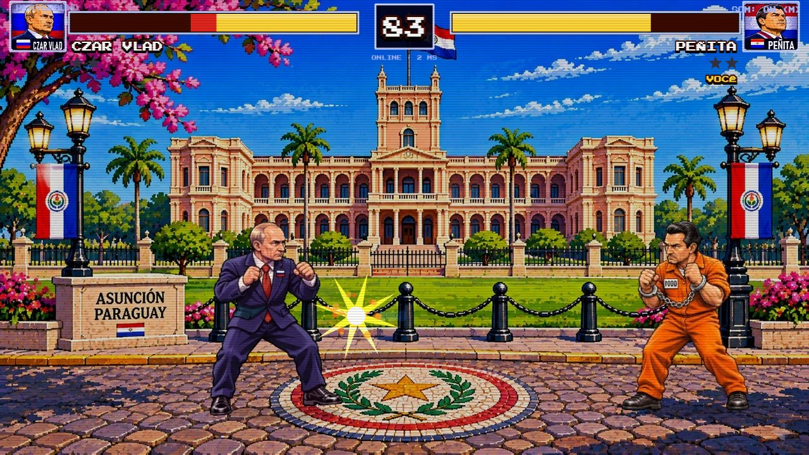

# Modo online

Dois jogadores, cada um no seu aparelho (celular, tablet ou computador), lutam pela internet. Não há servidor do jogo: os navegadores se ligam direto um ao outro.

## Como jogar

1. **Criar sala:** menu **ONLINE → CRIAR SALA**. Aparece um código de 4 dígitos e o botão **COMPARTILHAR LINK**, que usa o compartilhamento do celular ou copia o link no computador.
2. **Entrar:** o amigo escolhe **ENTRAR NA SALA** e digita o código no teclado da tela ou do computador. Também pode só abrir o link (`.../worldfight/?sala=1234`).
3. **Seleção:** cada um move apenas o próprio cursor e vê o cursor do outro em tempo real. Quem criou a sala é o **1P** (esquerda); quem entrou é o **2P**.
4. **Luta:** igual à local. Em cima aparecem "VOCÊ" e o ping. Online não tem pausa: Esc, P ou o botão ❚❚ abrem "SAIR DA LUTA?" e a luta continua atrás.
5. **Fim:** **REVANCHE** começa quando os dois pedem. **TROCAR LUTADOR** leva os dois para a seleção. **SAIR** encerra, e o outro vê "O OPONENTE SAIU".

## Conexão (`js/net.js`)

- **WebRTC com [PeerJS](https://peerjs.com/) 1.5.4**:
  - a biblioteca é baixada do jsDelivr só quando o modo online é aberto;
  - a sala é o identificador `world-fighter-sala-<código>` no servidor público e gratuito do PeerJS (`0.peerjs.com`);
  - esse servidor só faz a "sinalização", ou seja, apresenta um navegador ao outro. A luta não passa por ele.
- **Ligação direta:** depois da sinalização, os dados vão direto de um aparelho ao outro. Quando a rede não permite a ligação direta (algumas redes móveis e corporativas), o PeerJS usa um servidor TURN de retransmissão.
- **Canal confiável e ordenado** com mensagens JSON.
- **Ping a cada segundo:** sem notícia do outro lado por 15 segundos, a conexão é dada como perdida.
- **Código ocupado:** se o código sorteado já estiver em uso, o jogo sorteia outro.

## Sincronização: lockstep com atraso de entrada

O motor de luta é determinístico (veja [ARQUITETURA.md](ARQUITETURA.md)). Por isso os dois lados não precisam trocar o estado da luta, só os comandos.

1. O 1P sorteia a **semente** e o **cenário** e manda a mensagem `start` com os lutadores. Os dois lados criam o motor com a mesma semente.
2. A cada quadro, o lado local lê o teclado, o controle ou o toque e manda o comando, com **4 quadros de atraso** (`NET_DELAY`, 67 ms). Cada comando ocupa 7 bits: esquerda, direita, cima, baixo, defesa, soco e chute.
3. O quadro *N* só é calculado quando os comandos dos dois lados para *N* estão presentes. Com o atraso, o comando do outro lado normalmente já chegou e a luta não para. Se não chegou, o jogo espera; depois de 400 ms aparece "AGUARDANDO OPONENTE…".
4. A cada 120 quadros (2 s), os dois lados trocam um resumo do estado: vida, posição, estado e vitórias de cada lutador. Se divergirem, o console registra um aviso.
5. A troca de round acontece num quadro fixo do motor, e não no fim da animação da tela, para os dois lados trocarem juntos.

Como o atraso é fixo e não há *rollback*, o tempo de resposta sentido é de 67 ms mais metade do ping. É bom até uns 150 ms de ping. Acima disso a luta pode dar pequenas paradas.

### Mensagens

| Tipo | Quando | Conteúdo |
| --- | --- | --- |
| `ping` / `pong` | a cada segundo | hora do envio (mede o ping) |
| `cursor` | seleção | posição do cursor |
| `pick` / `unpick` | seleção | escolheu / desfez a escolha |
| `start` | o 1P inicia a luta | número da luta, lutadores, semente, cenário |
| `in` | luta | quadro inicial + lista de comandos (7 bits cada) |
| `sum` | luta, a cada 2 s | resumo do estado no quadro |
| `rematch` / `reselect` | resultado | pediu revanche / trocar lutador |
| `bye` | saída voluntária | o outro vê "O OPONENTE SAIU" |

As mensagens que chegam durante a troca de cena esperam numa fila até a próxima cena começar a escutar (`Net.listen`). Os comandos de lutas anteriores são descartados pelo número da luta.

## Testar

Para testar com dois navegadores no mesmo computador, abra o jogo em duas janelas **lado a lado**, ambas visíveis. Aba em segundo plano não roda o jogo, e o outro lado fica esperando.

Para um teste automático com dois navegadores sem janela, o Puppeteer serve: um cria a sala, o outro entra, os dois lutam com comandos aleatórios e o teste confere se as lutas terminam idênticas. Foi assim que o modo foi validado: luta inteira de 2 rounds (~6.000 quadros) idêntica nos dois lados, no servidor local e no site publicado.

## Limitações

- Precisa de internet nos dois aparelhos e do servidor público do PeerJS no ar.
- Sem *rollback*: com ping alto, a luta espera em vez de prever.
- Em algumas redes muito restritas, a conexão pode não fechar. Aparece "NÃO FOI POSSÍVEL CONECTAR".
- Minimizar o navegador ou trocar de app pausa o seu lado, e o outro fica esperando. Depois de 15 s sem resposta, a luta é encerrada.

Para usar um servidor de sinalização próprio, troque as opções de `new window.Peer(...)` em `net.js`. A documentação do PeerJS mostra como subir o `peerjs-server`.
